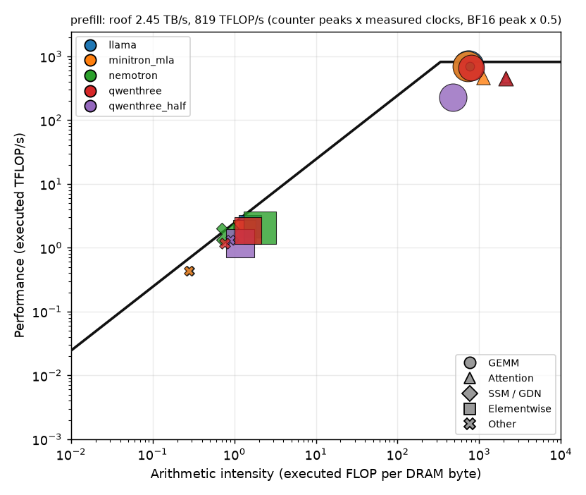
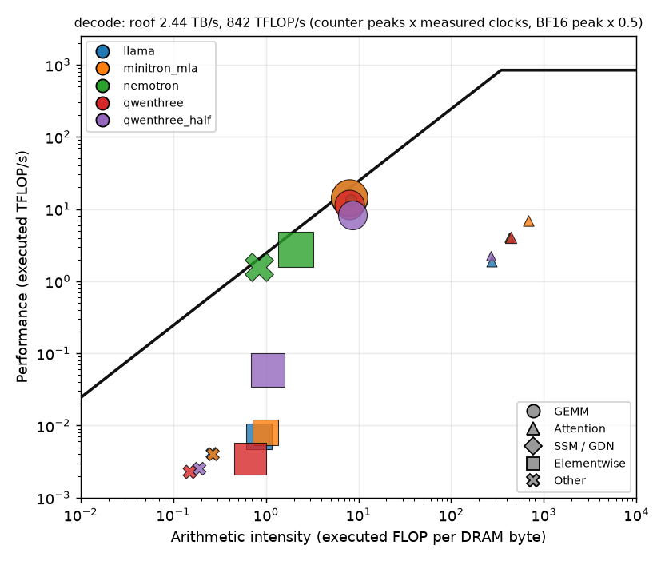
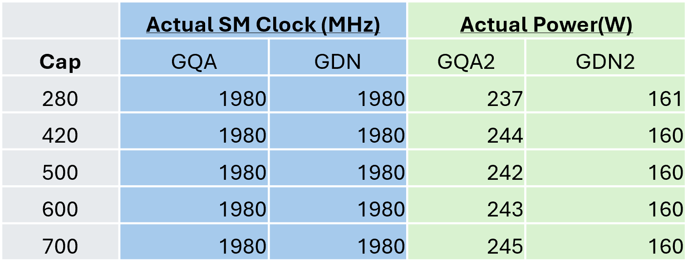
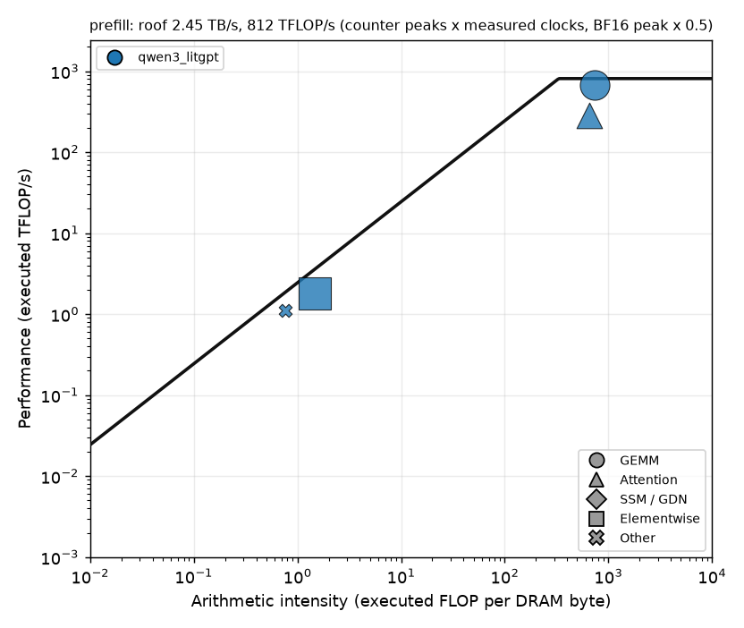
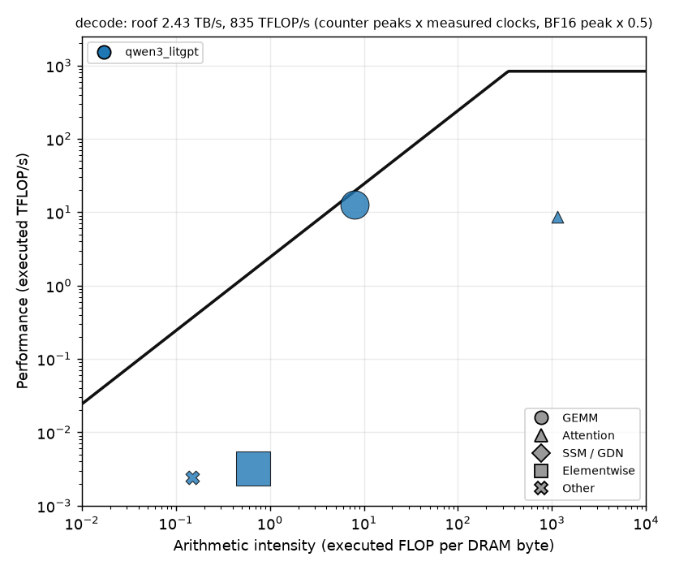

# Start-task

---

## First step: Environment setup

vLLM (<https://vllm.ai/>), PyTorch and the CUDA libraries can take up several GB. Therefore, first create a workspace instead of using `$HOME`. Run the following commands:

- `ws_allocate pwr_repro 60` = creates a workspace named `pwr_repro` for 60 days.
- `WS=$(ws_find pwr_repro)` = `ws_find` returns the path of the workspace; this path is stored in the `WS` variable for easier use.
- `echo $WS` = prints the workspace path.

---

## Second step: Necessary modules and downloads

### Modules and cache directories

The following commands load the Python module and set the pip and uv cache directories to the workspace (instead of `$HOME`):

- `module load python/3.12-conda`
- `export PIP_CACHE_DIR=$WS/pip_cache`
- `export UV_CACHE_DIR=$WS/uv_cache`

### Virtual environment

Create the virtual environment:

- `python -m venv $WS/venv`

Activate it:

- `source $WS/venv/bin/activate`

### Install vLLM

Download and install vLLM and its dependencies (CUDA, PyTorch):

- `uv pip install vllm`

---

## Third step: Downloading the models

Before downloading the models, set the Hugging Face cache location. The following command makes the models download into the workspace:

- `export HF_HOME=$WS/hf_cache`

### Models

- GQA (Qwen3-4B): <https://huggingface.co/Qwen/Qwen3-4B> (not sure yet)
- GQA-ctrl (Minitron-4B): <https://huggingface.co/nvidia/Llama-3.1-Minitron-4B-Depth-Base>
- MLA (Minitron-4B): <https://huggingface.co/nvidia/Llama-3.1-Minitron-4B-Depth-Base>
- GDN (Qwen3.5-4B): <https://huggingface.co/Qwen/Qwen3.5-4B>
- Mamba2 (Nemotron-Nano): <https://huggingface.co/nvidia/NVIDIA-Nemotron-3-Nano-4B-BF16>

After setting the model directory, run the following commands to download the models:

- `hf download nvidia/NVIDIA-Nemotron-3-Nano-4B-BF16`
- `hf download nvidia/Llama-3.1-Minitron-4B-Depth-Base`
- `hf download Qwen/Qwen3-4B`
- `hf download Qwen/Qwen3.5-4B`

### Installed versions

- vLLM = 0.31.0
- PyTorch = 2.13.0
- CUDA = 13.0
- Python = 3.12.7
- transformers = 5.17.0
- matplotlib = 3.11.2
- pandas = 3.1.0

---

## Fourth step: Shortcut to activate the environment after allocating a node

After allocating a node, run the following command. It activates the virtual environment and sets the directories (e.g. the workspace for the models):

- `source /hnvme/workspace/ihpc170h-pwr_repro/env.sh`

Then:

- `module load cuda/13.0.2` = loads the latest CUDA module.
- `export HF_HUB_OFFLINE=1` = disables loading models from the internet.

---

## Fifth step: Running the models

To run the models and collect the roofline metrics, use the following command. It runs the `run_models_hf.py` script, which measures the performance metrics of the prefill and decode phases:

- `bash submit_all.sh`

After the job finishes successfully, the CSV files with the performance metrics are saved to the `csv_out` folder.

### Creating the roofline plots

Copy the CSV files into the `csv_visual_try` folder, where the visualization script is located. Then run the following command in that folder:

- `python kernel_class_roofline.py llama_decode_s1024_bs_1_raw.csv llama_prefill_s4096_bs1_raw.csv`

> **Note:** Do not forget to copy all the CSV files. The results are saved to the `roofline_out` folder.

---

## Sixth step: Results

Clock = base = 1584 MHz



In prefill, the GEMM kernels sit on the right side of the ridge point. This means they are compute-bound.



In decode, the GEMM kernels sit on the left side of the ridge point. This means they are memory-bound.

---

## Interim step: TransMLA

The MLA model (converted from Minitron-4B with TransMLA) requires a different environment because of the different `transformers` version and package requirements.

### Create the new environment

- `module load python/3.12-conda`
- `python -m venv $HOME/venv_transmla` = creates the new virtual environment.
- `source $HOME/venv_transmla/bin/activate` = activates it. Alternatively, use the shortcut: `source $HOME/env_transmla.sh`

Set the pip cache and the model location:

- `export PIP_CACHE_DIR=$HOME/pip_cache`
- `export HF_HOME=$WS/hf_cache`

Install the required packages (with the environment activated):

- `pip install --upgrade pip`
- `pip install transformers==4.52.4 datasets "accelerate==1.3.0" datatrove tensorboardX`

### Convert the model

Run the conversion script. It converts Llama-3.1-Minitron-4B-Depth-Base to the MLA architecture and saves it to the workspace:

- `export HF_DATASETS_OFFLINE=1` = disables loading datasets from the internet.

```bash
python transmla/converter.py \
    --model-path nvidia/Llama-3.1-Minitron-4B-Depth-Base \
    --save-path $WS/outputs/minitron-4b-deepseek \
    --dtype bf16 \
    --device cuda:0 \
    --cal-dataset wikitext2 \
    --cal-nsamples 128 \
    --freqfold auto \
    --collapse auto \
    --qk-mqa-dim 64 \
    --kv-lora-rank 512 \
    --ppl-eval-batch-size 4
```

### Profile for the roofline

Submit one job for each phase:

- `sbatch profile_run_mla.sh minitron_mla /hnvme/workspace/ihpc170h-pwr_repro/outputs/minitron-4b-deepseek prefill`
- `sbatch profile_run_mla.sh minitron_mla /hnvme/workspace/ihpc170h-pwr_repro/outputs/minitron-4b-deepseek decode`

This script creates the CSV files in the same way as `submit_all.sh`. It was written only for the TransMLA model.

---

## Seventh step: Energy measurements

### Allocate a node

- `salloc --reservation=powercapped-ihpc170h-h100 --gres=gpu:h100:1 --time=02:00:00`

### Activate the environment and load the module

- `source /hnvme/workspace/ihpc170h-pwr_repro/env.sh`
- `module load cuda/13.0.2`
- `export HF_HUB_OFFLINE=1`

### Turn on persistence mode

- `sudo nvidia-smi -pm 1`

### Measure power and clock frequency

Run the following commands to measure power and clock frequency. The jobs write their results to the file `energy_profile_results.csv`.

GQA-ctrl:

```bash
sbatch --job-name="energy_gqactrl" --output="logs/energy_gqactrl_%j.log" --error="errors/energy_gqactrl_%j.err" sweep_power_cap.sh "nvidia/Llama-3.1-Minitron-4B-Depth-Base" 1 1024
```

GDN:

```bash
sbatch --job-name="energy_gdn" --output="logs/energy_gdn_%j.log" --error="errors/energy_gdn_%j.err" sweep_power_cap.sh "Qwen/Qwen3.5-4B" 1 1024
```

### Results on energy measurement



---

## Eighth step: litgpt

### Create the environment

To work with litgpt, create a new environment:

- `python -m venv $HOME/venv_litgpt`

Activate it:

- `source $HOME/venv_litgpt/bin/activate`

Then set the cache and model directories:

```bash
export PIP_CACHE_DIR=$HOME/pip_cache
export UV_CACHE_DIR=$HOME/uv_cache
export HF_HOME=$WS/hf_cache
```

### Install litgpt

- `pip install litgpt`

### Download the model

- `litgpt download Qwen/Qwen3-4B --checkpoint_dir $WS/litgpt_checkpoints`

The model is saved to the `$WS/litgpt_checkpoints` folder.

### Create the CSV reports

- `sbatch --job-name=qwen3_prefill profile_run_litgpt.sh qwen3_litgpt /hnvme/workspace/ihpc170h-pwr_repro/litgpt_checkpoints/Qwen/Qwen3-4B prefill`
- `sbatch --job-name=qwen3_decode profile_run_litgpt.sh qwen3_litgpt /hnvme/workspace/ihpc170h-pwr_repro/litgpt_checkpoints/Qwen/Qwen3-4B decode`

This script creates the CSV files in the same way, under `csv_out`.

### Visualize

Copy the CSV files to the `csv_visual_litgpt` folder and run the visualization script:

- `python kernel_class_roofline.py qwen3_litgpt_decode_s1024_bs_1_raw.csv qwen3_litgpt_s4096_bs1_raw.csv`

### Results



In prefill, the GEMM kernels sit on the right side of the ridge point. This means they are compute-bound.



In decode, the GEMM kernels sit on the left side of the ridge point. This means they are memory-bound.