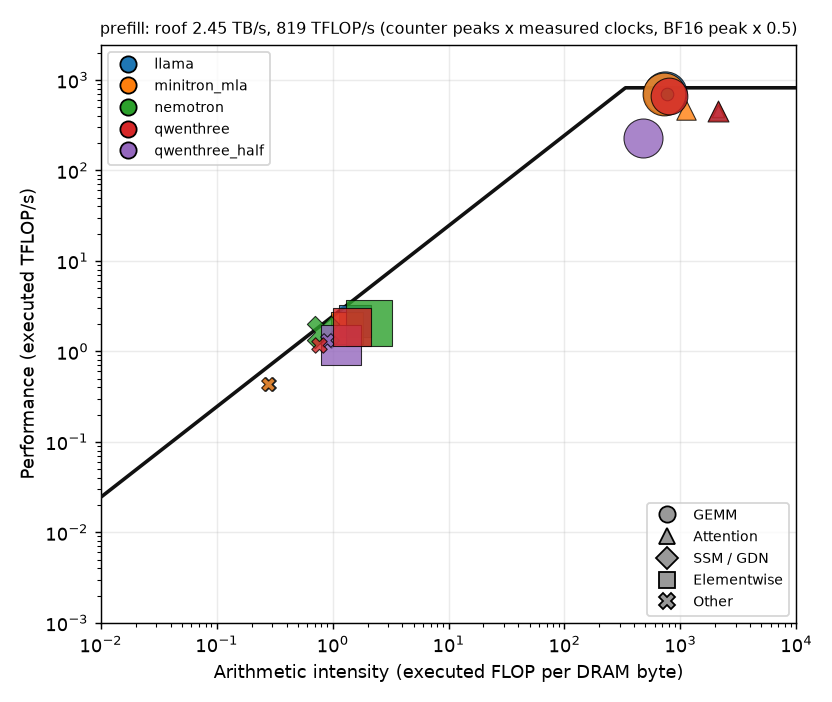
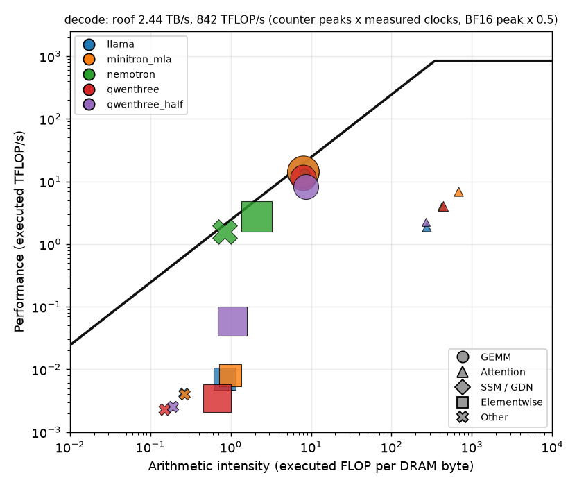

## Start-task

### First Step: Environment setup:
- vLLM <https://vllm.ai/>, pytorch and cuda libraries might be GBs. Therefore, first proceed with creating a directory:

- `ws_allocate pwr_repro 60` = creates workspace for 60 days named pwr_repro. 
- `WS=$(ws_find pwr_repro)` = ws_find gives the path of this workspace, later this path is assocated to WS variable to easier use.
- `echo $WS`

### Second step: necessary modules and downloads:
- `module load python/3.12-conda`
- `export PIP_CACHE_DIR=$WS/pip_cache`
- `export UV_CACHE_DIR=$WS/uv_cache` 

These 2 exports routes the pip and uv caches to workspace instead of $HOME.

- `python -m venv $WS/venv`: creates an virtual python environment in workspace.
- `source $WS/venv/bin/activate` : activates the environment.

- `pip install --upgrade pip uv` : updates the pip and install uv
- `uv pip install vllm` : downloads and installs vllm and its' dependencies (cuda, pytorch).

### Third Step: downloading the models
- `export HF_HOME=$WS/hf_cache` : indicats where the huggingface models will be downloaded
- `which hf` : tells whether the hf command is downloaded.

#### Models:
- GQA(Qwen3-4B) : <https://huggingface.co/Qwen/Qwen3-4B> - not sure
- GQA-ctrl(Mintron-4B) : <https://huggingface.co/nvidia/Llama-3.1-Minitron-4B-Depth-Base>
- MLA (Mintron-4B): <https://huggingface.co/nvidia/Llama-3.1-Minitron-4B-Depth-Base>
- GDN(Qwen3.5-4b) : <https://huggingface.co/Qwen/Qwen3.5-4B> - not sure
- Mamba2(nemotron-nano): <https://huggingface.co/nvidia/NVIDIA-Nemotron-3-Nano-4B-BF16>

- `hf download nvidia/NVIDIA-Nemotron-3-Nano-4B-BF16`
- `hf download nvidia/Llama-3.1-Minitron-4B-Depth-Base`
- `hf download Qwen/Qwen3-4B`
- `hf download Qwen/Qwen3.5-4B`

### installed version:
- vllm= 0.31.0
- pytorch = 2.13.0
- cuda= 13.0 
- python= 3.12.7
- transformers = 5.17.0
- matplotlib==3.11.2
- pandas==3.1.0

### Fourth step: allocate a node and check the environment
- `source /hnvme/workspace/ihpc170h-pwr_repro/venv/bin/activate` = activate the venv in the node
- `export HF_HOME=/hnvme/workspace/ihpc170h-pwr_repro/hf_cache` = find the model cache directory

- `module load cuda/13.0.2` = load the  latest cuda module

### Fifth step: run the model

run the script to collect the csv reports
- `bash submit_all.sh`

then copy the reports to csv_visual_try folder. Later,
- `cd csv_visual_try`
- `python kernel_class_roofline.py llama_decode_s1024_bs_1_raw.csv llama_prefill_s4096_bs1_raw.csv`

Note: do not forget to put the all csv files. The results will be saved to roofline_out folder.

### Sixth step: Results

In prefill GEMM kernels sits on the right side of the ridge point. This means compute-bound.

In decode GEMM kernels sits on the left side of the ridge point. This means memory-bound.

Clock = base = 1584 MHz

### Interim step: TransMLA
It requires different environment because of the 'Transformers' versions and different package requirements.

New environment
- `module load python/3.12-conda`
- `python -m venv $HOME/venv_transmla`

pip/uv caches to work 
- `export PIP_CACHE_DIR=$HOME/pip_cache`

models location
- `export HF_HOME=$WS/hf_cache`

required packages 
- `pip install --upgrade pip`
- `pip install transformers==4.52.4 datasets "accelerate==1.3.0" datatrove tensorboardX`

activate the env
- `source $HOME/venv_transmla/bin/activate`

or easily
- `source $HOME/env_transmla.sh`

profile for roofline:

- `sbatch profile_run_mla.sh minitron_mla /hnvme/workspace/ihpc170h-pwr_repro/outputs/minitron-4b-deepseek prefill`
- `sbatch profile_run_mla.sh minitron_mla /hnvme/workspace/ihpc170h-pwr_repro/outputs/minitron-4b-deepseek decode`

### Seventh step: Energy Measurements
In venv (for Table 1):

 GQA-ctr = `sbatch --job-name="energy_gqactrl" --output="logs/energy_gqactrl_%j.log" --error="errors/energy_gqactrl_%j.err" sweep_power_cap.sh "nvidia/Llama-3.1-Minitron-4B-Depth-Base" 1 1024`

 GDN = `sbatch --job-name="energy_gdn" --output="logs/energy_gdn_%j.log" --error="errors/energy_gdn_%j.err" sweep_power_cap.sh "Qwen/Qwen3.5-4B" 1 1024 `

 
 ### litgpt
 create env
 - `python -m venv $HOME/venv_litgpt`
 activate env
 - `source $HOME/venv_litgpt/bin/activate`

 then
 - `export PIP_CACHE_DIR=$HOME/pip_cache`
   `export UV_CACHE_DIR=$HOME/uv_cache`
   `export HF_HOME=$WS/hf_cache`

install litgpt
- `pip install litgpt`

to download a model
- `litgpt download Qwen/Qwen3-4B --checkpoint_dir $WS/litgpt_checkpoints`

the model is saved to $WS/litgpt_checkpoints folder.

create the csv reports
- `sbatch --job-name=qwen3_prefill profile_run_litgpt.sh qwen3_litgpt /hnvme/workspace/ihpc170h-pwr_repro/litgpt_checkpoints/Qwen/Qwen3-4B prefill`

-`sbatch --job-name=qwen3_decode profile_run_litgpt.sh qwen3_litgpt /hnvme/workspace/ihpc170h-pwr_repro/litgpt_checkpoints/Qwen/Qwen3-4B decode`